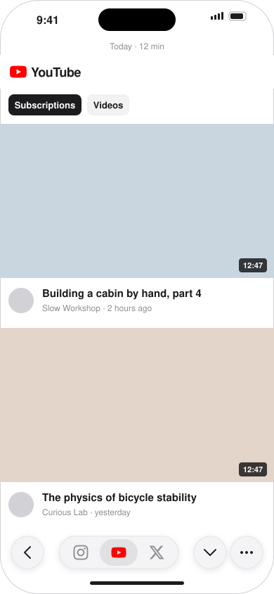
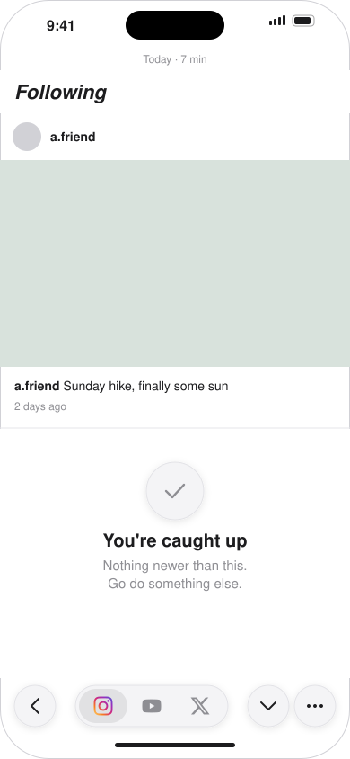
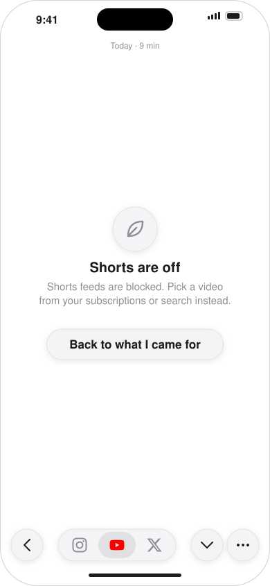
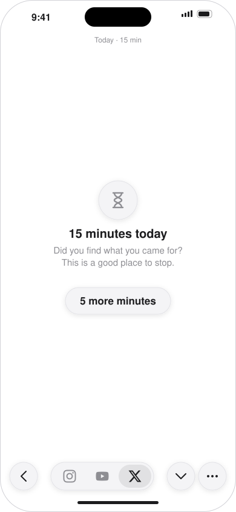
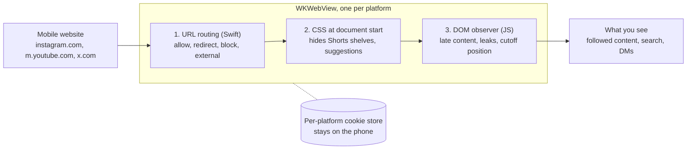

# FocusFeed

**A calm iPhone browser for Instagram, YouTube and X: what you follow and what you search for, without Reels, Shorts or endless algorithmic feeds.**


## Why

iOS does not let any app change the official Instagram, YouTube or X apps, and Screen Time can only block a whole app. Third-party filters work around this by wrapping the mobile websites, but then a stranger's app sees your logins and session cookies.

FocusFeed is a small, self-built alternative. It loads the real mobile sites in `WKWebView`s and removes everything designed for passive consumption before it renders. There is no backend, no analytics and no third-party code, and your credentials never leave the device.

## Features

- **Three platforms, one app**: Instagram, YouTube and X in separate web views with separate cookie stores, switched from a Liquid Glass bottom bar.
- **Doomscroll surfaces blocked by URL**: Reels feed, Explore, Shorts, Trending and "For you" show a calm card instead.
- **Algorithmic content hidden in-page**: Shorts shelves, suggested posts, "Who to follow" and similar blocks are removed by CSS and a DOM observer.
- **"You're caught up" stop**: following feeds end after 48 hours of posts; search results stop after one page unless you ask for more.
- **One reel at a time**: a reel sent in a DM plays, but swiping on to the next one is blocked.
- **Daily timer**: "Today · N min" at the top, and a gentle nudge after 15 minutes with a "5 more minutes" option.
- **Leak detection**: the menu turns into a warning when a filter stops matching, and a stats sheet shows what was hidden or leaked on the current page.
- **Privacy by construction**: no `URLSession`, no packages, no cookie or keychain access, enforced by `make audit`.

## Screenshots

Mockups of the main screens, drawn from the SwiftUI views:

| Subscriptions feed | Caught up | Blocked surface | Daily nudge |
| :---: | :---: | :---: | :---: |
|  |  |  |  |

## What stays and what goes

| Platform | Keep | Remove |
| --- | --- | --- |
| Instagram | Following feed, Stories, profiles, search, DMs, single reels | Reels feed and pager, Explore grid, suggested posts and accounts |
| YouTube | Subscriptions (start page), Home (one page, no Shorts), channels, search, watch page, playlists | Shorts everywhere, Trending/Explore, end-screen cards, autoplay |
| X | Following timeline, profiles, search, lists, DMs, notifications | "For you" (forced to Following), Explore/Trending, "Who to follow", Grok and upsells |

## How it works



URL rules do most of the work because they do not depend on the sites' markup. The injected scripts run in an isolated content world and only read the DOM and set attributes. See [docs/architecture.md](docs/architecture.md) for components, the navigation lifecycle and the security model.

## Tech stack

| Area | Choice |
| --- | --- |
| Language | Swift (Swift 5 language mode), plain JavaScript for filters |
| UI | SwiftUI with iOS 26 Liquid Glass, `WKWebView` via `UIViewRepresentable` |
| Project | [XcodeGen](https://github.com/yonaskolb/XcodeGen) (`project.yml`), Make |
| Tests | XCTest (routing, filter fixtures, cutoff, timer), XCUITest smoke tests |
| Dependencies | None |

## Getting started

### Prerequisites

- macOS with **Xcode 26** or newer (iOS 26 SDK and an iOS simulator runtime)
- [Homebrew](https://brew.sh) (used to install XcodeGen)
- For a real device: an iPhone on iOS 26 with Developer Mode on, and an Apple ID added in Xcode (a free Personal Team is enough)

### Install

```bash
git clone https://github.com/michalilski/focus-feed.git
cd focus-feed
make setup
```

`make setup` checks Xcode, installs XcodeGen if needed, creates the git-ignored local config files from their templates and generates `FocusFeed.xcodeproj`.

### Configure

Signing and device settings live in two git-ignored files created by `make setup`:

| File | Setting | Where to find it |
| --- | --- | --- |
| `Config/Local.xcconfig` | `DEVELOPMENT_TEAM` | Xcode → Settings → Accounts, or the team ID in your "Apple Development" certificate |
| `Config/local.mk` | `DEVICE` | `xcrun devicectl list devices` with the phone connected |

Neither is needed for the simulator. If the bundle ID `com.michalilski.focusfeed` is already registered to another team, change `bundleIdPrefix` and the `PRODUCT_BUNDLE_IDENTIFIER` values in `project.yml`, plus `BUNDLE_ID` in the `Makefile` and `scripts/live_probe.sh`.

### Run in the simulator

```bash
make sim         # build, install and launch on the "iPhone 17 Pro" simulator
make test        # unit tests
make uitest      # UI smoke tests (loads the real sites, needs internet)
make audit       # privacy audit
```

Use another simulator with `make sim SIMULATOR="iPhone 17"`.

### Install on your iPhone (free provisioning)

```bash
make device
```

This builds a signed Release build, installs it over USB (or Wi-Fi after the first time) and launches it. On the very first install, trust the developer on the phone: **Settings → General → VPN & Device Management → your Apple ID → Trust**.

With a free Personal Team the app **stops launching 7 days after it was built**. Plug the phone in and run `make device` again; logins and data are kept because the bundle ID stays the same. A paid Apple Developer Program membership extends this to one year.

## Make targets

| Target | What it does |
| --- | --- |
| `make setup` | First-time setup: XcodeGen, local config files, project generation |
| `make gen` | Regenerates `FocusFeed.xcodeproj` from `project.yml` (run after adding or removing files) |
| `make build` | Debug build for the simulator |
| `make test` / `make uitest` | Unit tests / UI smoke tests; full log in `build/test.log` |
| `make audit` | Fails if network, analytics, package or cookie-reading code appears |
| `make sim` | Build, install and launch in the simulator |
| `make device` | Signed Release build, installed and launched on the iPhone |
| `make pull-snapshots` | Copies DOM snapshots saved on the phone into `snapshots/` (git-ignored) |
| `make icon` | Redraws the app icon |
| `make clean` | Deletes `build/` |

`./scripts/live_probe.sh <instagram|youtube|x> <url> [seconds]` opens one URL in the simulator and writes a screenshot, the DOM and filter stats to `build/probe/`.

## Project structure

```
focus-feed/
├── project.yml                 XcodeGen project definition
├── Makefile                    build, test, install and maintenance targets
├── Config/                     signing xcconfig + templates for local settings
├── FocusFeed/
│   ├── App/                    app entry, RootView, SessionStore, launch options
│   ├── Platforms/              one profile and rule set per platform
│   ├── Routing/                Router, route rules, redirect and reel guards
│   ├── Web/                    BrowserSession, web view factory, filter bridge, scroll limit
│   ├── Usage/                  daily timer
│   ├── UI/                     bottom bar, calm cards, browser screen, filter stats
│   └── Resources/Filters/      common.js engine + instagram.js, youtube.js, x.js
├── FocusFeedTests/             router, filter fixture, cutoff and timer tests
│   └── Fixtures/               small HTML pages annotated with expected visibility
├── FocusFeedUITests/           launch and bottom bar smoke tests
├── scripts/                    setup, test runner, live probe, privacy audit, icon
└── docs/                       architecture, product brief, implementation plan, images
```

## Limitations

- Passkeys do not work in a web view inside a non-browser app; log in with password and a 2FA code.
- "Sign in with Google/Apple" pop-ups on X and Instagram are not supported.
- The sites change their markup. When a filter breaks, the menu shows a warning; the leak-fix workflow is described in [docs/plan/3-testing-strategy.md](docs/plan/3-testing-strategy.md).
- This is a personal tool, not an App Store app.

## License

[MIT](LICENSE) © 2026 Michał Ilski
