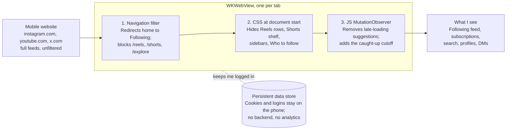

# FocusFeed — a calm browser for Instagram, YouTube and X

Oct 1, 2026 · Michał

## Problem and goal

FocusFeed is a personal iPhone app that opens Instagram, YouTube and X in a filtered browser showing only what I follow, plus search. Everything built for passive consumption — Reels, Shorts, recommendations, infinite algorithmic feeds — is removed before it renders.

Why build it myself: iOS lets no app modify the official Instagram, YouTube or X apps, and Screen Time can only block a whole app. Third-party filters solve this by wrapping the mobile websites, but they see my logins and session cookies. A self-built app keeps that trust problem off the table: no backend, no analytics, credentials never leave the device.

Success looks like: I can check posts from people I follow, watch videos from my subscriptions, search for something specific, and there is never a feed that keeps going on its own.

## What stays and what goes

The rule is the same on all three: keep followed content, profiles, search and messages; remove anything chosen by an algorithm or designed to autoplay the next item.

| Platform | Keep | Remove |
| --- | --- | --- |
| Instagram | Following feed (chronological), Stories of followed accounts, profiles, search, DMs, my own posting | Reels tab and in-feed Reels, Explore grid, "Suggested for you" posts and accounts, home feed defaulted to Following |
| YouTube | Subscriptions feed (start page), Home recommendations (full videos only, one page), channel pages, search results, watch page for a chosen video with related videos, playlists | Shorts everywhere (shelf, tab, in Home and related lists, `/shorts/` URLs), Trending/Explore, end-screen cards, autoplay |
| X | Following timeline, profiles, search, lists, DMs, notifications | "For you" tab (forced to Following), Explore/Trending, "Who to follow", recommended posts injected into replies |

Two deliberate frictions apply everywhere: the following feed stops after a fixed number of items (e.g. last 48 hours) with a "you're caught up" screen, and search results never autoload more than one page.

## How it works

Each tab is a `WKWebView` loading the real mobile site, with three filter layers between the site and the screen. This is the same approach the paid apps use, minus anyone else's server.

URL rules are the most robust layer, so they do most of the work; CSS and the observer script handle what can't be caught by URL.

## Scope

One SwiftUI app with three tabs — Instagram, YouTube, X — installed on my own phone through Xcode. No App Store release, so no review constraints. Filtering is URL redirects plus CSS/JS hide rules, edited in code.

Out of scope: other platforms, a settings screen, backend, accounts, sync. To make it stick, I delete the official apps and hide their websites from Safari with Screen Time content restrictions.

## Risks and mitigations

| Risk | Mitigation |
| --- | --- |
| Sites change their markup and filters silently stop working | Prefer stable hooks (URLs, `aria-label`, `href` patterns) over class names; add a debug overlay that counts hidden elements per page so breakage is visible |
| Mobile web is weaker than the native apps (e.g. Instagram web posting, X video quality) | Accept it; the friction is partly the point |
| Login blocked or flagged as unusual | Use the standard Safari mobile user agent; keep cookies in a persistent `WKWebsiteDataStore` so I log in once |
| I bypass it by reinstalling the official apps | Screen Time passcode held by someone else, or App Store installs disabled |
| Free Apple developer signing expires every 7 days | Paid developer account ($99/year) for 1-year signing, or rebuild weekly from Xcode |
| Terms of service | Filtering my own client-side view is low risk; no scraping, no automation of actions |

## Build plan with Claude Code

Roughly four evenings of work, each step ending with something usable on the phone.

1. **Shell app.** Ask Claude Code for a SwiftUI project with a `TabView` of three `WKWebView`s, a shared persistent data store, and back/forward/reload controls. Install via Xcode and log in to all three sites.
2. **YouTube first** (easiest, most stable URLs). Open on `/feed/subscriptions`, rewrite `/shorts/<id>` to `/watch?v=<id>`, inject CSS hiding Shorts everywhere and end screens, and disable autoplay. Home and related videos stay, without Shorts (changed 2026-10-01 at Michał's request).
3. **Instagram.** Force `?variant=following` on the home feed, block `/reels/` and `/explore/` with a placeholder screen, and hide suggested blocks via a `MutationObserver` script.
4. **X.** Select the Following tab on load, block `/explore`, hide "Who to follow" and trending modules.
5. **Friction layer.** "Caught up" cutoff on each following feed and a debug overlay counting what was hidden.
6. **Daily use for one week**, then fix whatever leaked through.

Tip for Claude Code: give it the table in this doc as the spec, and when something leaks, paste the page's HTML snippet for that element and ask for a selector based on `href` or `aria-label` rather than class names.
