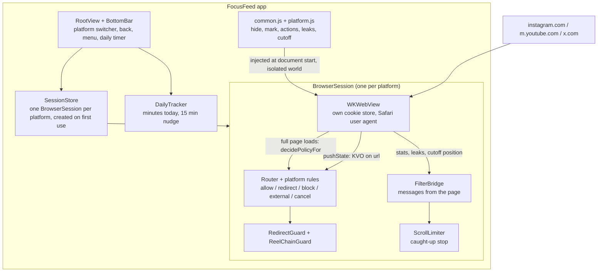
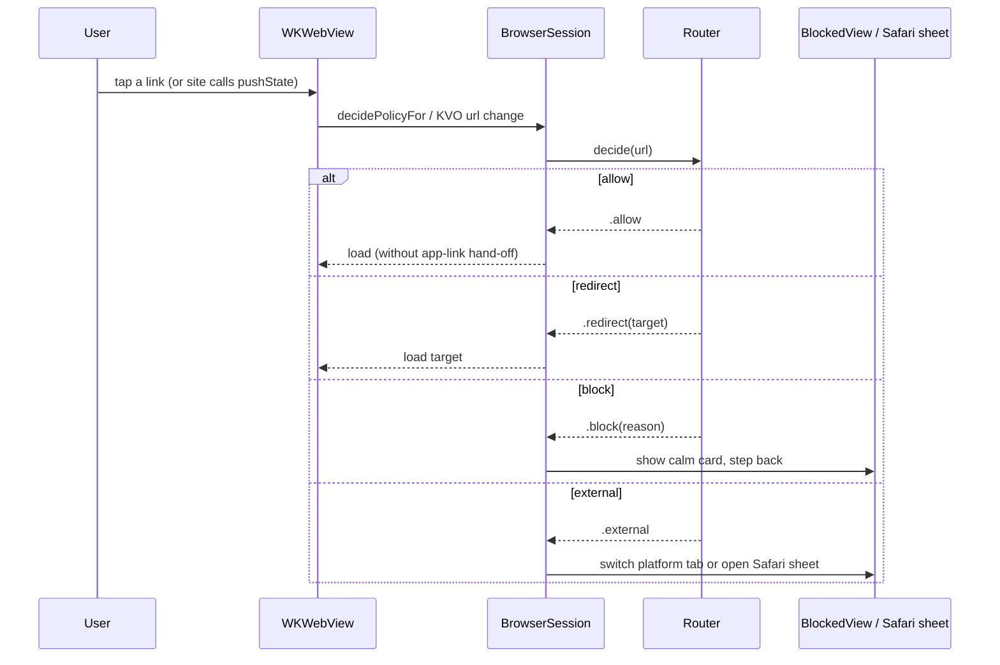

# Architecture

FocusFeed is one SwiftUI app with one `WKWebView` per platform. Each web view loads the real mobile website, and three filter layers sit between the site and the screen. There is no backend, no third-party code and no analytics.

## Components

## Navigation lifecycle

## Layer 1: URL routing

Swift, in `FocusFeed/Routing` and `FocusFeed/Platforms`. `Router.decide(url)` walks the ordered `RouteRule`s of a `PlatformProfile`; the first rule that returns a decision wins, otherwise the URL is allowed. Adding a platform or a rule never changes `Router`.

| Decision | Meaning | What `BrowserSession` does |
| --- | --- | --- |
| `.allow` | Normal page | Loads it |
| `.redirect(url)` | Rewrite, e.g. `/shorts/<id>` to `/watch?v=<id>` | Loads the target instead |
| `.block(reason)` | Doomscroll surface | Shows `BlockedView`; if the page already switched (pushState) it goes back |
| `.external` | Host is not part of this platform | Switches to another platform tab or opens a Safari sheet |
| `.cancel` | Non-https scheme (`instagram://`, App Store links, `http`) | Drops it |

The URL is also watched with KVO, because the three sites are single-page apps and most in-app navigation never reaches `decidePolicyFor`.

## Layers 2 and 3: filter scripts

JavaScript, in `FocusFeed/Resources/Filters`. `common.js` defines a small engine; each platform script calls `FocusFeed.install({...})` once:

| Key | Effect |
| --- | --- |
| `hide` | CSS `display: none !important` rules added at document start |
| `mark` | Elements found by a function get a hiding attribute; re-evaluated on every DOM change |
| `actions` | Small fixes run on every DOM change, e.g. selecting the Following tab |
| `leaks` | Counts rendered elements that should never be visible, so a broken selector is noticed |
| `cutoff` | Reports the page Y position where scrolling must stop (by post age or by depth) |

Scripts run in `WKContentWorld.defaultClient`, so the page's own scripts cannot see them. They post only `stats` and `cutoff` messages back to Swift.

## Caught-up stop

The cutoff is a native scroll limit plus a native `CaughtUpPanel`, not elements inserted into the page. Following feeds on Instagram and X stop at posts older than 48 hours (three old posts in a row). Search results and the YouTube feeds stop after a fixed depth and offer "Show one more page".

## Security model

1. No third-party code: no Swift packages, CDN scripts or SDKs.
2. The app makes no network requests of its own; only the web views talk to the sites you open.
3. Credentials are typed into the real site over HTTPS. Swift never reads form fields, cookies or the keychain.
4. Cookies stay on the phone, in one `WKWebsiteDataStore` per platform.
5. Injected scripts are isolated and passive: no `fetch`, no `document.cookie`, no storage.
6. Navigation is allow-listed per platform; other hosts open in a Safari sheet.
7. Web Inspector is enabled only in Debug builds.
8. DOM snapshots are a manual debug action, saved to the git-ignored `snapshots/` folder.

`make audit` (`scripts/privacy_audit.sh`) checks these rules in the source and fails if one is broken.

## Further reading

The full design notes, decisions and the phase-by-phase implementation log are in [`docs/plan/`](plan/), starting with [`1-overview-and-architecture.md`](plan/1-overview-and-architecture.md). The original product brief is [`docs/FocusFeed.md`](FocusFeed.md).
