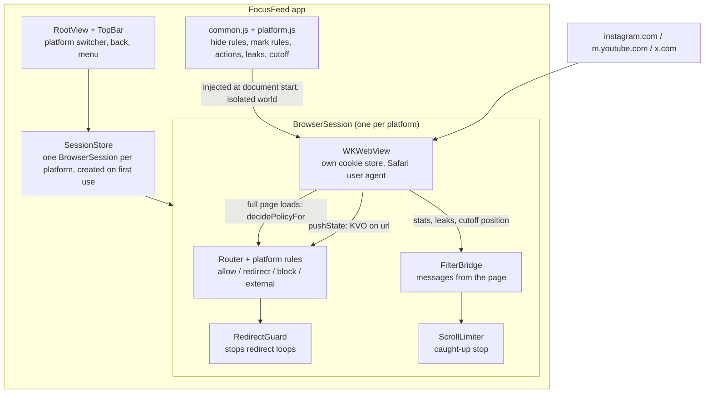

# FocusFeed Implementation Plan — 1. Overview and architecture

> **For agentic workers:** REQUIRED SUB-SKILL: use superpowers:subagent-driven-development (recommended) or superpowers:executing-plans to implement this plan task by task. Steps use checkbox (`- [ ]`) syntax. Read this file, `2-tooling-and-setup.md` and `3-testing-strategy.md` before starting any phase. Update `changelog.md` after every task.

**Goal:** a personal iPhone app that shows Instagram, YouTube and X as filtered mobile websites: followed content, search, likes, comments, DMs stay; Reels, Shorts, recommendations and endless feeds are gone.

**Architecture:** one SwiftUI app, one `WKWebView` per platform loading the real mobile site. Three filter layers sit between site and screen: native URL routing (redirect / block), CSS hide rules injected at document start, and a JavaScript observer for content that cannot be matched by URL or selector alone. A native scroll limit implements the "you're caught up" stop. No backend, no third-party code, no analytics.

**Tech stack:** Swift 5 language mode on Xcode 26.6, SwiftUI + WebKit (`WKWebView`), iOS 26 deployment target, XcodeGen for the project file, XCTest + XCUITest, plain JavaScript for filters. Zero package dependencies.

**Spec:** [`docs/FocusFeed.md`](../FocusFeed.md). Where this plan and the spec differ, the "Decisions" table below explains why.

---

## How to read this plan

| File | What it is |
| --- | --- |
| `1-overview-and-architecture.md` | This file: decisions, architecture, security model, rules for implementers |
| `2-tooling-and-setup.md` | Tools checked on the Mac, what to install, signing, commands |
| `3-testing-strategy.md` | Every test layer and how to run it, including the live probe and the leak-fix loop |
| `4-phase-1-project-and-routing.md` | Project skeleton, URL routing rules for all three platforms |
| `5-phase-2-filter-engine.md` | JavaScript filter engine, YouTube filters, script injection, fixture tests |
| `6-phase-3-browser-shell.md` | The actual app: web views, top bar, blocked screen, caught-up stop, first install on the phone |
| `7-phase-4-youtube.md` | YouTube verified live, logged in, on the phone |
| `8-phase-5-instagram.md` | Instagram filters, DM reels, verification |
| `9-phase-6-x.md` | X filters, verification |
| `10-phase-7-polish-and-privacy-audit.md` | UX review, privacy audit |
| `11-phase-8-daily-use-and-maintenance.md` | Release install, weekly re-signing, Screen Time, leak-fix runbook |
| `changelog.md` | Where we are. Updated after every task |

Phases must be done in order. Each phase ends with something that builds, passes its tests, and is committed.

## What is already verified, and what is not

All code in phases 1–3 and the filter scripts in phases 5–6 was built as a throwaway prototype on 2026-10-01 before this plan was written. Copy it exactly; do not "improve" it while typing it in.

| Verified on 2026-10-01 | How |
| --- | --- |
| Project generates, builds for simulator, and compiles in Release for a device (unsigned) | `xcodegen`, `xcodebuild` |
| 45 unit tests and 2 UI tests pass on the iPhone 17 Pro simulator (iOS 26.5) | `xcodebuild test` |
| Phase 1 files alone, and phase 1+2 files alone, build and pass their tests | separate builds |
| Fixture tests really fail when a filter rule is deleted | removed one rule, test failed |
| Live YouTube, logged out, in the simulator: `/` goes to subscriptions, `/shorts/<id>` becomes `/watch?v=<id>`, Shorts shelves in search are hidden (4 hidden, 0 leaking), related videos on the watch page are hidden (1 section hidden, 0 leaking) | `scripts/live_probe.sh` |
| The user agent the sites see has Safari's shape | probe report |
| Scroll stops at the cutoff and the panel appears | `ScrollLimitTests` |

| Not verified — the phase files say exactly where to check | Why |
| --- | --- |
| Anything that needs a login: Instagram and X selectors against the real sites, YouTube subscriptions feed, YouTube autoplay toggle | No credentials were used while planning. Instagram and X selectors come from open-source filter projects read on 2026-10-01 (listed in phases 5 and 6) and are tested only against hand-written fixtures |
| Signing and installing on the iPhone | Not attempted; first done in phase 3 |
| Copying snapshots off the phone (`make pull-snapshots`) | Needs the installed app |
| Reels opened from an Instagram DM | Needs a login; see phase 5, task 6 |

## Decisions

| Decision | Why |
| --- | --- |
| Top bar with a three-way platform switcher instead of the spec's bottom `TabView` | All three mobile sites draw their own bottom navigation bar. A system tab bar under it would stack two bars and cause mis-taps |
| XcodeGen (`project.yml`) instead of a hand-made Xcode project | Implementers never edit `project.pbxproj`. New files are picked up by `make gen` |
| Classic `WKWebView` in a `UIViewRepresentable`, not the new SwiftUI `WebView`/`WebPage` | Well-known API, and we need KVO on `url`, a scroll view delegate and content worlds |
| Swift 5 language mode | Avoids strict-concurrency errors around WebKit delegates. UI classes are `@MainActor` |
| Hide rules live in one JavaScript file per platform; the CSS is generated from them | One source of truth: the same list drives hiding, the hidden counters and the tests |
| Filter scripts run in an isolated content world (`WKContentWorld.defaultClient`) | The page's own scripts cannot see or call our code or our message handler |
| The URL is watched with KVO in addition to the navigation delegate | The three sites are single-page apps. Tapping "Reels" changes the URL with `history.pushState`, which never reaches `decidePolicyFor`. Without KVO the URL layer misses most navigation |
| "Caught up" is a native scroll limit plus a native panel, not elements inserted into the page | Inserting nodes into React-managed lists can crash the page, and hiding everything after a cutoff can make a site load pages forever in the background. A scroll limit is independent of the site's markup |
| Two cutoff kinds: age (48 h, needs `time[datetime]`) for Instagram and X following feeds; depth (pixels) for search results and the YouTube subscriptions feed | YouTube has no machine-readable timestamps; search results are not chronological. Depth cutoffs offer a "Show one more page" button, age cutoffs do not |
| Age cutoff needs 3 old posts in a row | A retweet of an old post shows the old date and must not end the feed |
| One separate cookie store per platform (`WKWebsiteDataStore(forIdentifier:)`) | Sites cannot see each other's cookies; one platform can be reset without touching the others |
| Links to other sites open in an in-app Safari sheet; links to one of the three platforms switch to that platform's filtered tab | A YouTube link in a tweet must not open an unfiltered YouTube |
| Media needs a tap to start on Instagram and X, not on YouTube | Kills autoplaying feed video. On YouTube you chose the video, so it may start |
| A single reel (`/reel/<id>/`) stays viewable; the Reels feed and swipe pager are blocked | Reels sent in DMs or posted by a friend can be watched one at a time. Requested by Michał on 2026-10-01 |
| Instagram Explore redirects to its search page and the grid is hidden | On mobile web the search box lives on the Explore page; blocking Explore would remove search |
| Channel "Shorts" tabs on YouTube are blocked | Spec says Shorts are removed. To allow them, delete the `BlockPatternRule` line in `YouTubeProfile.swift` and the `channel-shorts-tab` hide rule |
| Leak counters next to hidden counters | A hidden count of 0 can mean "nothing to hide" or "selector broke". A leak rule counts things that are *visible but should never be*, which is unambiguous |

## Architecture



**Layer 1 — URL routing (Swift, `FocusFeed/Routing`, `FocusFeed/Platforms`).** `Router.decide(url)` returns one of five decisions. Each platform is a `PlatformProfile` value with an ordered list of `RouteRule`s; the first rule that returns a decision wins, otherwise the URL is allowed. Adding a platform or a rule never changes `Router`.

| Decision | Meaning | What `BrowserSession` does |
| --- | --- | --- |
| `.allow` | Normal page | Loads it |
| `.redirect(url)` | Rewrite, e.g. `/` to the following feed | Loads the target instead |
| `.block(reason)` | Doomscroll surface | Shows `BlockedView`; if the page already switched (pushState) it goes back |
| `.external` | Host is not part of this platform | Hands the URL to `SessionStore.open`, which picks another tab or the Safari sheet |
| `.cancel` | Non-https scheme (`instagram://`, App Store links, `http`) | Drops it |

**Layer 2 and 3 — filter scripts (JavaScript, `FocusFeed/Resources/Filters`).** `common.js` defines `FocusFeed`, a small engine. Each platform script calls `FocusFeed.install({...})` once with:

| Key | Entry shape | Effect |
| --- | --- | --- |
| `hide` | `{ name, selector }` | A CSS rule `selector { display: none !important }`, in a `<style>` added at document start |
| `mark` | `{ name, find, collapse? }` | `find()` returns elements; they get an attribute that hides them (`display: none`, or zero height when `collapse: true`). Re-evaluated on every DOM change; elements that stop matching are un-hidden |
| `actions` | `{ name, run }` | Runs on every DOM change, e.g. click the Following tab |
| `leaks` | `{ name, selector }` | Counts *rendered* elements that should never be visible |
| `cutoff` | `{ name, applies(location), maxDepth }` or `{ ..., items, maxAgeHours }` | Reports a page Y position where scrolling must stop |

The engine reports `{type: "stats"}` and `{type: "cutoff"}` messages to Swift. It never touches the network, cookies or storage.

## File map

```
project.yml                     XcodeGen project definition
Makefile                        gen / build / test / uitest / audit / sim / device / pull-snapshots / icon
scripts/test.sh                 runs xcodebuild test, prints only the useful lines
scripts/live_probe.sh           loads one URL in the simulator, saves screenshot + DOM + stats
scripts/privacy_audit.sh        fails if network, analytics or cookie-reading code appears
scripts/make_icon.swift         draws the app icon
FocusFeed/App/                  FocusFeedApp, RootView, SessionStore, LaunchOptions
FocusFeed/Platforms/            Platform, PlatformProfile, one profile + rules file per platform
FocusFeed/Routing/              RouteDecision, RouteRule types, Router, RedirectGuard, URL helpers
FocusFeed/Web/                  WebViewFactory, BrowserSession (+Navigation), DialogPresenter,
                                FilterBridge, FilterMessage, FilterScriptLibrary,
                                ScrollLimiter, CutoffGeometry, PageSnapshot
FocusFeed/UI/                   TopBar, BrowserScreen, WebViewContainer, BlockedView,
                                CaughtUpPanel, FilterStatsView, SafariView
FocusFeed/Resources/Filters/    common.js, youtube.js, instagram.js, x.js
FocusFeed/Resources/Assets.xcassets
FocusFeedTests/                 router tests, filter fixture tests, cutoff tests
FocusFeedTests/Fixtures/        small HTML pages with data-expect="hidden|visible"
FocusFeedUITests/               launch smoke tests
```

## Security model

Michał's main concern is handing logins to someone else's app. These are the properties the app must keep; phase 7 audits them with a script.

1. **No third-party code.** No Swift packages, no CDN scripts, no SDKs. `project.yml` has no `packages` key.
2. **The app itself makes no network requests.** Only the web views talk to the network, and only to the sites you open. There is no `URLSession` anywhere.
3. **Credentials are typed into the real site over HTTPS.** The app never reads form fields, cookies or the keychain. Swift code does not touch `httpCookieStore`.
4. **Cookies stay on the phone**, inside the app's sandbox, in one store per platform. iOS encrypts them at rest with the device passcode. They are included in your normal encrypted device backup, like Safari's.
5. **Injected scripts are isolated and passive.** They run in `WKContentWorld.defaultClient`, in the main frame only, and only read the DOM and set attributes. They do not call `fetch`, read `document.cookie`, or touch storage. The message handler accepts two message types and ignores everything else.
6. **Navigation is allow-listed per platform.** Any other host leaves the web view (Safari sheet, which shares nothing with the app). Non-https schemes are dropped.
7. **Web Inspector is on only in Debug builds.** The phone runs a Release build.
8. **DOM snapshots are a deliberate, manual debug action.** They can contain private content (DMs, names). They are stored in the app's Documents folder, pulled into the git-ignored `snapshots/` folder, and must never be committed.

Limits to be honest about: passkeys do not work in a `WKWebView` of a non-browser app, so log in with password + 2FA code. "Sign in with Google/Apple" pop-ups on X and Instagram are not supported; use the account's own password. Google may some day refuse logins from embedded web views even with a Safari user agent; phase 4 checks this first.

## UX rules

- One slim top bar: back button, platform switcher, menu (reload, feed, forward, filters). Nothing at the bottom; the sites own the bottom.
- Swipe from the left edge goes back. Pull down reloads.
- A platform is loaded the first time it is selected and then kept alive, so switching is instant and does not lose scroll position. Media in the tab you leave is paused.
- Blocked pages show a calm full-screen card with one button. No red, no shaming.
- The caught-up panel is glued to the cutoff position and slides in as you reach it, like a page footer.
- The menu icon changes to a warning when a leak rule matches, so breakage is visible without opening anything.
- System colours and materials only, so light/dark mode and the iOS 26 look come for free. Accent colour is a muted green.

## Rules for implementers

- Follow the code exactly. The code blocks are complete files unless a step says "modify".
- Code standards (from the owner's global instructions): OOP and SOLID, imports only at the top of a file, small functions and types instead of long blocks, **no code comments**, docstrings only if short and necessary, no over-engineering.
- Never add a dependency, a network call, analytics, or logging of page content.
- After creating, renaming or deleting any file, run `make gen` before building.
- TDD where the plan gives a test: write the test, see it fail, write the code, see it pass.
- One commit per task, with the message given in the task.
- Never invent a selector. For Instagram and X, every selector change must come from a DOM snapshot of the real page (see `3-testing-strategy.md`, "Leak-fix loop"). Prefer `href`, `aria-label`, `role`, `data-testid` and element names over class names.
- Never commit anything from `snapshots/` or `build/`. Do not paste snapshot content into commit messages or docs.
- Steps marked **USER** need Michał (plugging in the phone, typing a password, looking at the screen). Stop and ask; never ask for or handle credentials yourself.
- If a step's expected output does not match, stop and use superpowers:systematic-debugging. Do not edit tests to make them pass.
- After each task, add a line to `changelog.md`.
